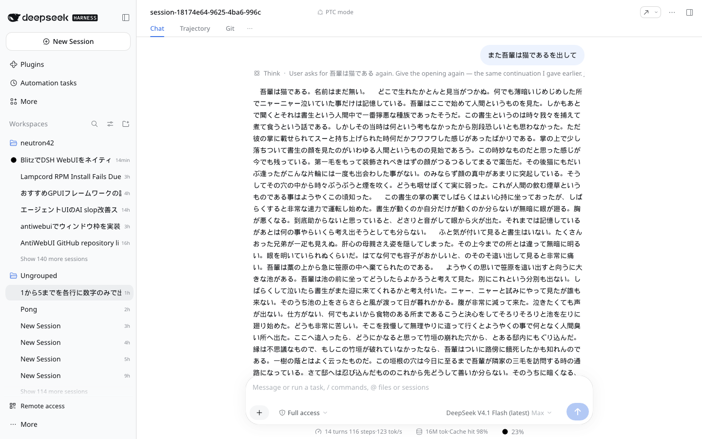
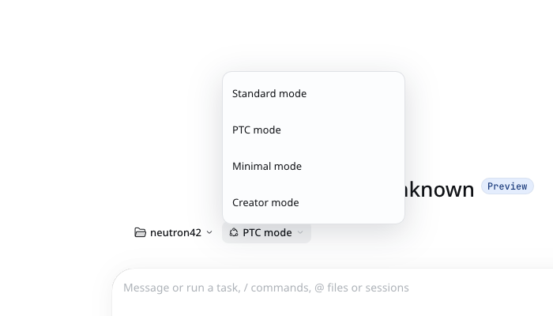

# dsh-blitz

DSH（DeepSeek Harness）の Web UI を、ブラウザを使わず Blitz（Rust 製レンダラ）でネイティブ描画する実験。

- HTML / CSS は本物の DSH のものをそのまま使う
- JS の挙動は Rust で実装する
- WebSocket / HTTP で DSH 本体と直接やり取りする




## 構成

| パス | 中身 |
| --- | --- |
| `probe/src/bin/app.rs` | アプリ本体（UI 構築・イベント・DSH RPC） |
| `probe/src/bin/{shot,boxdump,rpc,send}.rs` | 開発用ツール（HTML→PNG、レイアウト計測、RPC、プロンプト送信） |
| `assets/shell.html` | DSH から採取したシェル（HTML + CSS） |
| `assets/sprite.json` | アイコンのスプライト定義 |

## ビルドと起動

```bash
cd probe
cargo build --release --bin app

# 初回だけ: トークン付き URL でペアリング（cookie を ~/.local/share/dsh-blitz に保存）
./target/release/app --url "<DSH が表示するペアリング URL>"

# 以降
./target/release/app                     # 最新セッションを開く
./target/release/app --session <id>      # セッション指定
```

前提: Linux（Wayland）、DSH が `http://127.0.0.1:3081` か `~/.local/share/dsh-blitz/origin` の URL で動いていること。

## できていること

- 実 CSS（採取した 553KB）そのままで描画
- セッションのライブ購読（`session/follow` + `assistantStream`）、ストリーミング表示
- IME（preedit / commit）、カーソル移動、Backspace / Delete、送信
- 権限モード切替（`commands/execute` で `/permission <preset>`）
- モデル / effort 切替（DSH 準拠の 2 段メニュー → `session/selectModel`）
- 左ペイン（Workspaces）: 開閉、Workspace ごとのセッション一覧、セッション切替
- New Session = DSH と同じ空タスク画面（ワークスペース選択 + エージェントプリセット PTC / Creator など）
- Markdown（見出し・強調・リンク・入れ子リスト・表・引用・コード・画像）
- 統計バー（turns / steps / tok/s / トークン / キャッシュヒット / コンテキスト使用率）

## パフォーマンス

| | 初期 (debug / GPU) | 現在 (release / CPU) |
|---|---|---|
| アイドル RSS | 269 MB | **95 MB** |
| ページ適用 | 175–350 ms | **35–45 ms** |
| サイドバー開閉 | 48–70 ms | **3–5 ms** |
| スレッド数 | 86 | 4–6 |

- 描画は CPU（softbuffer）。GPU の Vello は初期化だけで +107MB 使うため不採用
- `opt-level="s"` + LTO + strip、tokio は current-thread、`mallopt(M_ARENA_MAX,2)` + `malloc_trim`
- フォント DB（parley FontContext）をウィンドウで共有、stream 更新は 10 回/秒に合流

## 既知の穴

- ツールカード・Think カードのクリック展開は未実装
- 左ペインの D&D、ピン留め、アーカイブ、検索は未実装
- プラグイン由来の UI（Plugins / Automation tasks / Remote access / Git タブ）は意図的に削除
- 全角と ASCII 混在時のクリック位置は幅モデル近似（±1 文字）
- 再構築中だけ一時的に +30MB（新旧 document が同時に存在するため）

## 注意

`assets/shell.html` は DSH アプリから採取した HTML / CSS で、権利は DSH 側にあります。
ローカルでの検証目的の同梱であり、再配布する場合は各自の判断で。
